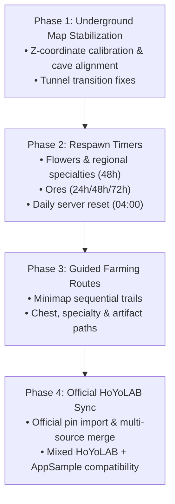

# 🗺️ Development Roadmap — Hexen Map

[Português (Brasil)](ROADMAP.md) · **English**

This document outlines the major milestones planned for **Hexen Map**, prioritizing practical exploration improvements requested by the community, non-invasive automation, and system stabilization.

---

## 🎯 Key Upcoming Features

### 1. 🌿 Guided Farming Routes (Materials, Chests & Artifacts)
- **Step-by-Step Routes on the Overlay:** Interactive sequential display of optimized collection routes directly over the minimap and full-screen map.
- **Regional Specialty Routes:** Dedicated paths for character ascension materials (e.g., Silk Flowers, Onikabuto, Luminescent Pollen).
- **Chest & Puzzle Routes:** Sub-region trails designed to guide 100% exploration completion across new and legacy zones.
- **Daily Artifact Inspection Routes (1★ & 2★):** Optimized speed routes factoring in the daily server investigation cap (100 spots/day).
- **Smart Waypoint Progression:** The next route waypoint highlights automatically as the player collects the current resource or moves closer.

---

### 2. ⏳ Real-Time Respawn Timers
- **Local Specialties & Flowers (48 Hours):** Accurate real-time countdown starting immediately upon resource collection (automated or manual).
- **Ores & Minerals:**
  - Iron Chunk: 24 hours.
  - White Iron Chunk: 48 hours.
  - Crystal Chunk, Magical Crystal Chunk & Amethyst: 72 hours.
- **Elite Enemies & Common Monsters:** Aligned with official server reset time (04:00 AM server local time).
- **World Bosses:** Short respawn countdown timer (3 minutes) upon exiting the boss arena.
- **Visual Status Cues:** Collected pins dim to gray displaying remaining time, regaining full vibrancy when the resource is ready for harvesting again.

---

### 3. 🌐 Official HoYoverse Map Integration (HoYoLAB)
- **Syncing Official Chests & Collected Pins:** Direct import and synchronization of collected items, oculi, and challenges recorded on the player's official HoYoLAB Interactive Map account.
- **100% Safe & Non-Invasive:** Transparent retrieval without requiring confidential user credentials or violating game terms of service.
- **Multi-Source Progress Merging:** Seamless merging between AppSample datasets, official HoYoLAB data, and locally marked Hexen Map pins, complete with previews, conflict detection, and automated backups.

---

### 4. 🕳️ Underground Map Fixes & Calibration (Multi-Layer Caves)
- **Fixing Cave Map Desynchronization:** Correcting coordinate drift and alignment bugs in multi-elevation maps (Sumeru rainforest & desert, The Chasm: Underground Mines, Enkanomiya, Sea of Bygone Eras).
- **Refining Cave Detection (`underground_detector`):** Eliminating false triggers during transitions between surface terrain and deep cave tunnels.
- **Automatic Floor/Layer Switching:** Seamlessly aligning displayed pins with the exact vertical layer where the player is currently exploring.

---

## 🛠️ Implementation Phases

---

## 💬 Feedback & Community

Have ideas, suggestions, or specific cave bugs to report?
- Use the **Report** button inside the Hexen Map footer.
- Follow along and contribute on [GitHub Issues & Discussions](https://github.com/victoregit/HexenMap/issues).
