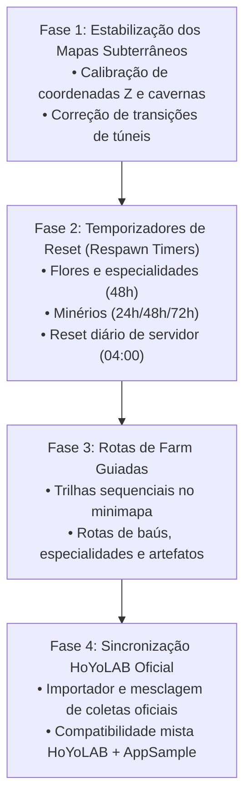

# 🗺️ Roadmap de Desenvolvimento — Hexen Map

**Português (Brasil)** · [English](ROADMAP.en.md)

Este documento apresenta os próximos grandes marcos planejados para o **Hexen Map**, priorizando melhorias práticas de exploração solicitadas pela comunidade, automação não invasiva e estabilização de sistemas.

---

## 🎯 Próximos Grandes Recursos

### 1. 🌿 Rotas de Farm Guiadas (Materiais, Baús e Artefatos)
- **Rotas Passo a Passo no Overlay:** Visualização sequencial e interativa de rotas otimizadas sobre o minimapa e o mapa expandido.
- **Rotas de Especialidades Regionais:** Rotas dedicadas aos materiais de ascensão de personagens (ex.: Flores da Seda, Besouros Onikabuto, Fungos Fluorescentes).
- **Rotas de Baús e Quebra-cabeças:** Trilhas por sub-regiões para guiar 100% da exploração de mapas novos e antigos.
- **Rotas de Artefatos Diários (1★ e 2★):** Sequência otimizada com contagem do limite diário de inspeções (100 spots/dia).
- **Avanço Inteligente de Rota:** O próximo ponto da rota se destaca automaticamente conforme o jogador coleta o item atual ou se aproxima dele.

---

### 2. ⏳ Temporizadores de Reset de Recursos (Respawn Timers)
- **Especialidades e Flores Locais (48 horas):** Contagem regressiva precisa em tempo real iniciada no momento exato da coleta (automática ou manual).
- **Minérios:**
  - Pedaço de Ferro: 24 horas.
  - Pedaço de Ferro Branco: 48 horas.
  - Pedaço de Cristal, Cristal Mágico e Ametista: 72 horas.
- **Inimigos de Elite e Monstros Comuns:** Reset alinhado ao horário oficial do servidor (04:00 da manhã do fuso horário da conta).
- **Chefes de Mundo:** Timer curto de respawn (3 minutos) após sair da arena.
- **Indicadores Visuais de Status:** Pins coletados permanecem em cinza com indicador de tempo restante e recuperam a cor brilhante quando o recurso estiver disponível novamente.

---

### 3. 🌐 Integração com o Mapa Oficial da HoYoverse (HoYoLAB)
- **Sincronização de Baús e Marcações Oficiais:** Possibilidade de importar itens coletados, óculos e desafios registrados diretamente na conta do Mapa Interativo Oficial da HoYoLAB.
- **Arquitetura 100% Segura e Não Invasiva:** Leitura transparente sem solicitar credenciais confidenciais ou violar termos de serviço.
- **Mesclagem Inteligente de Fontes:** Integração contínua entre progresso do AppSample, dados da HoYoLAB oficial e marcações feitas diretamente pelo Hexen Map, com prévia, detecção de conflitos e backup automático.

---

### 4. 🕳️ Correção e Calibração dos Mapas Subterrâneos (Cavernas Multicamadas)
- **Resolução de Desalinhamentos em Cavernas:** Correção de bugs de sincronia de coordenadas nos mapas com múltiplas elevações (Sumeru, Deserto, Minas Subterrâneas do Despenhadeiro, Enkanomiya e Mar do Passado).
- **Refinamento do Detector de Cavernas (`underground_detector`):** Redução de falsos positivos na transição entre superfície e túneis profundos.
- **Troca Automática de Camada (Andares):** Alinhamento contínuo dos pins com a camada vertical exata onde o jogador se encontra, evitando confusão entre superfície e subsolo.

---

## 🛠️ Fases de Implementação

---

## 💬 Sugestões e Acompanhamento

Tem uma sugestão ou encontrou um caso específico para incluir nas correções?
- Use o botão **Report** no rodapé do painel do Hexen Map.
- Acompanhe e contribua nas [Discussões do GitHub](https://github.com/victoregit/HexenMap/issues).
